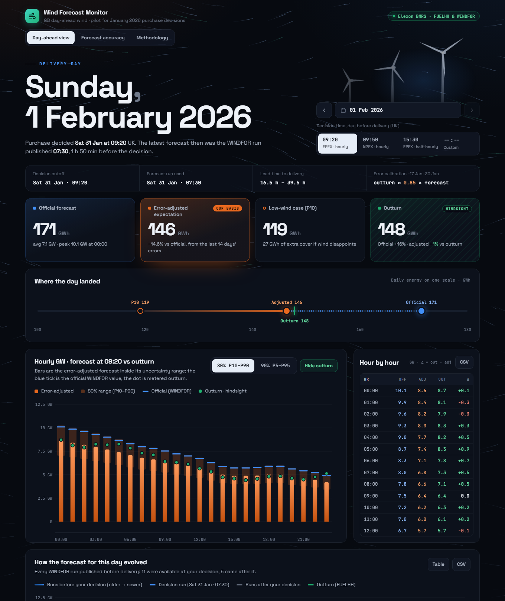
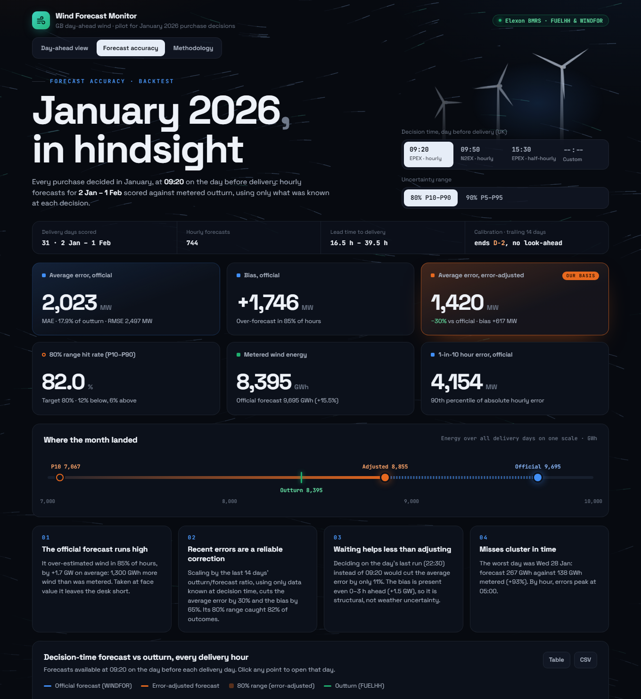
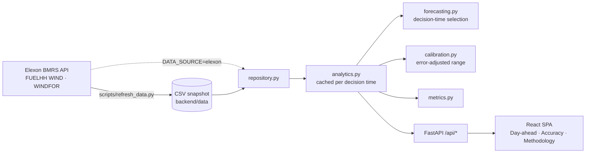

# Wind Forecast Monitor: GB day-ahead wind

A web app for a UK utility's day-ahead trading desk. It shows:

1. **The latest national wind forecast that was available when the day-ahead purchase was decided**, hour by hour, with how it evolved.
2. **How accurate that forecast is**, measured against metered outturn, and an **error-adjusted forecast with an uncertainty range** that turns the measured error into numbers a trader can act on.

Scope, as briefed: purchase decisions made in **January 2026**, using only Elexon BMRS **FUELHH** (wind outturn) and **WINDFOR** (wind forecast) data.

| | |
|---|---|
| **Live app** | **https://wind-generation-forecast.vercel.app** |
| **Video walkthrough** | _add the unlisted YouTube link here_ |
| **Stack** | React 19 + TypeScript (Vite, Recharts) · Python 3.12 + FastAPI + pandas · Docker |



## Headline findings (deciding at 09:20 on the day before delivery)

Backtest over the 31 delivery days whose purchase decision fell in January 2026 (2 Jan – 1 Feb), 744 hourly forecasts:

| | Official WINDFOR forecast | Error-adjusted forecast |
|---|---|---|
| Mean absolute error | 2,023 MW (17.9% of outturn) | **1,420 MW (−30%)** |
| Bias (forecast − outturn) | +1,746 MW; too high in 85% of hours | +617 MW (−65%) |
| Energy over the period | 9,695 GWh vs 8,395 GWh metered (+15.5%) | 8,855 GWh (+5.5%) |
| 80% range hit rate | n/a | 82.0% (target 80%) |

- **The official forecast runs systematically high** against metered outturn. The bias is already present 0–3 h ahead (+1.5 GW), so it is structural (coverage and curtailment), not weather uncertainty.
- **Waiting barely helps; adjusting does.** Deciding on the day's last run (22:30) instead of 09:20 cuts the error by only 11%. Adjusting with the last 14 days' errors at 09:20 cuts it by 30%, using only information available at the time.
- **Misses cluster.** The worst delivery day was 28 Jan (forecast 267 GWh vs 138 GWh metered), coinciding with Storm Chandra.



## Quick start

### Docker (recommended)

```bash
docker compose up --build
# open http://localhost:8000
```

One container serves both the API (`/api/*`, interactive docs at `/api/docs`) and the built React app.
The January 2026 data snapshot ships with the image, so no API keys or network access to Elexon are needed.

### Local development

Requires Python 3.12+ and Node 20.19+ (tested on Node 24).

```bash
# API on http://localhost:8000
cd backend
python -m venv .venv
.venv/Scripts/activate            # Windows (macOS/Linux: source .venv/bin/activate)
pip install -r requirements-dev.txt
uvicorn app.main:app --reload

# UI on http://localhost:5173, proxying /api to :8000 (second terminal)
cd frontend
npm ci
npm run dev
```

### Checks

```bash
cd backend  && ruff check . && ruff format --check . && pytest                  # 45 tests
cd frontend && npm run lint && npm run typecheck && npm test && npm run build  # 24 tests
```

The same checks, plus a Docker build and container smoke test, run in GitHub Actions on every push ([.github/workflows/ci.yml](.github/workflows/ci.yml)).

### Refreshing the data

```bash
cd backend
python -m scripts.refresh_data       # re-pulls FUELHH (WIND) and WINDFOR from the Elexon API into backend/data
```

Set `DATA_SOURCE=elexon` to have the API fetch the same window live at startup instead of reading the snapshot.

## Repository layout

```
.
├── backend/                     Python API (FastAPI + pandas)
│   ├── app/
│   │   ├── main.py              App factory: routers, gzip, CORS, cache headers, serves the built SPA
│   │   ├── api.py               HTTP routes; validation only, delegates to analytics
│   │   ├── schemas.py           Pydantic response contracts (mirrored in frontend/src/api/types.ts)
│   │   ├── analytics.py         Use cases: day-ahead view, accuracy backtest, horizon analysis (cached)
│   │   ├── forecasting.py       Picks the forecast available at the decision time; forecast vintages
│   │   ├── calibration.py       Error-adjusted forecast and prediction interval (no look-ahead)
│   │   ├── metrics.py           MAE, RMSE, bias, WAPE, interval hit rate and breakdowns
│   │   ├── repository.py        Loads the data snapshot (or fetches live) and writes snapshots
│   │   ├── elexon.py            Elexon BMRS client: retries, chunked requests, payload normalisation
│   │   ├── timeutils.py         UK local-time helpers (delivery days, decision cutoffs, DST)
│   │   └── settings.py          Scope (January 2026 decisions), auction presets, configuration
│   ├── data/                    Snapshot fetched from Elexon: wind_actuals.csv, wind_forecasts.csv, manifest.json
│   ├── scripts/refresh_data.py  Re-fetches the snapshot from the Elexon API
│   ├── tests/                   pytest: unit tests, API tests on synthetic data, golden numbers on the snapshot
│   ├── requirements.txt         Pinned runtime dependencies
│   ├── requirements-dev.txt     + pytest, ruff
│   └── pyproject.toml           ruff and pytest configuration
├── frontend/                    React + TypeScript single-page app (Vite)
│   ├── src/
│   │   ├── App.tsx              Shell: header, tabs, shared filter row, URL state
│   │   ├── pages/               DayAheadPage, AccuracyPage, MethodologyPage
│   │   ├── charts/              One Recharts component per chart + shared axis helpers
│   │   ├── components/          Hero, stat cards, energy scale, hourly table, chart cards (table view + CSV), controls
│   │   ├── api/                 Typed API client and response types
│   │   ├── hooks/               useApi (cached fetch, keeps the previous frame), useUrlState, useElementWidth
│   │   ├── lib/                 Formatting (UK time), chart data shaping, insights, CSV, series colours
│   │   └── styles/              Design tokens (light/dark) and app styles
│   ├── index.html
│   ├── vite.config.ts           Dev proxy to the API, Vitest config
│   └── package.json
├── pyproject.toml               Vercel manifest: pinned Python dependencies + FastAPI entrypoint
├── vercel.json                  Vercel build command and function settings
├── Dockerfile                   Multi-stage build: Node builds the UI, Python serves API + UI
├── docker-compose.yml           `docker compose up` for local use
├── heroku.yml                   Heroku container deploy (alternative to Vercel)
├── .github/workflows/ci.yml     Lint, type-check, tests, build and container smoke test
└── docs/screenshots/            Images used in this README
```

## Architecture



- **Layered backend.** I/O (`elexon`, `repository`), pure analytics functions (`forecasting`, `calibration`, `metrics`), use-case orchestration (`analytics`), a thin HTTP layer (`api`, `schemas`). The analytics are plain functions over DataFrames, so they are unit-tested without HTTP.
- **Snapshot-first data.** January 2026 is history. Bundling the fetched data makes the app fast, deterministic and independent of Elexon's availability. Fetching from Elexon took 2–35 s per request during development. The same client code produces the snapshot and the optional live mode.
- **Explicit API contract.** Pydantic models define every response. `frontend/src/api/types.ts` mirrors them, and OpenAPI docs are at `/api/docs`.
- **Caching.** Results are cached per `(decision time, coverage)` (LRU). API responses carry `Cache-Control` for browser and CDN caching, and are gzip-compressed (the accuracy payload goes from 110 KB to 20 KB).
- **Frontend.** The URL holds the state (`?date=2026-01-21&t=09:20&range=80`), so any view can be shared as a link. All times show on the UK clock regardless of the viewer's time zone. Every chart has a table view and CSV export. The dark trading-desk theme (Space Grotesk and JetBrains Mono, bundled locally) uses a colour-blind-checked palette in which each series keeps one colour everywhere: official forecast blue, error-adjusted orange, outturn green. Behind it, a decorative wind-flow field (a small canvas particle simulation, `lib/windField.ts`) and turbine silhouettes set the scene. The field draws at 30 fps, pauses when the tab is hidden, and shows a still frame for users who prefer reduced motion.

### API

| Endpoint | Purpose |
|---|---|
| `GET /api/meta` | Scope, decision-time presets, calibration settings, data coverage |
| `GET /api/day-ahead?date=YYYY-MM-DD&decision_time=HH:MM&coverage=80` | One delivery day: decision-time forecast, adjusted forecast and range, outturn, forecast vintages |
| `GET /api/accuracy?decision_time=HH:MM&coverage=80` | Backtest over all delivery days: metrics, daily, by hour, by wind level, error histogram, hourly series |
| `GET /api/horizon` | Error by forecast lead time (all runs) and by decision time on D−1 |
| `GET /api/health` | Liveness |

## Methodology (summary)

The in-app **Methodology** tab has the full version.

- **Scope.** Decisions made 1–31 Jan 2026 buy for delivery days 2 Jan – 1 Feb 2026 (UK settlement days, 00:00–24:00 local).
- **Decision time.** A UK clock time on D−1. Presets are the GB day-ahead gate closures: 09:20 (EPEX hourly, default), 09:50 (N2EX), 15:30 (EPEX half-hourly). Any custom time is also allowed.
- **Forecast available at the decision.** For each target hour, the latest WINDFOR value published *strictly before* the cutoff. Selection is per hour, so a late run falls back to the previous one. One January run was published at 12:25 instead of 11:30 and is handled naturally.
- **Matching.** WINDFOR is hourly and FUELHH half-hourly. Forecasts are matched to the settlement period starting at the same `startTime`. Matching against the hourly mean or a centred mean instead changes MAE by less than 1%.
- **Metrics.** `error = forecast − outturn` (positive means wind under-delivered). The app reports MAE, RMSE, bias, WAPE (rather than MAPE, which breaks in low-wind hours), the P90 absolute error, and the interval hit rate.
- **Error-adjusted forecast.** `adjusted = forecast × median(outturn/forecast)` and `range = forecast × [P10, P90]` of the same ratio. The ratios come from the previous 14 complete delivery days, ending at D−2: the last day whose outturn is known when deciding on D−1. So the backtest never uses future information. This needs a short history before 2 Jan, so data from 18 Dec 2025 is included.
- **Why multiplicative.** It matched the error structure best (the gap grows with wind level). In a causal backtest it beat additive and level-binned variants on accuracy or calibration.

## Deployment

- **Vercel (live at https://wind-generation-forecast.vercel.app).** This uses Vercel's FastAPI runtime:
  - The root `pyproject.toml` pins the Python dependencies and points Vercel at `backend.app.main:app`. A backend test keeps those pins identical to `backend/requirements.txt`.
  - The build command in `vercel.json` builds the React app.
  - FastAPI registers the built app with `app.frontend()`, and Vercel promotes those files to its CDN. Every `/api/*` request reaches the function, with the data snapshot bundled.
  - To deploy, run `vercel deploy --prod` from the repo root.
- **Heroku (alternative, uses the Dockerfile).** Run `heroku create`, then `heroku stack:set container`, then `git push heroku main`. The container listens on `$PORT`.
- **Anywhere else that runs containers.** `docker build -t wind-forecast-monitor . && docker run -p 8000:8000 wind-forecast-monitor`.

## Development practices

- **Tests where correctness matters.** UK clock changes, strict "published before" selection, per-hour fallback, no-look-ahead calibration, the metric definitions, the API contract, and golden numbers on the real snapshot. Frontend tests cover time-zone-safe formatting, chart data shaping and CSV escaping.
- **Static checks.** `ruff` (lint and format) for Python. ESLint (including React hooks rules) and strict TypeScript for the frontend.
- **Reproducibility.** Exact dependency versions are pinned (Python requirements and `package-lock.json`). A data manifest records what was fetched and when.
- **CI.** GitHub Actions runs backend, frontend and Docker jobs on every push.
- **Accessibility and UX.** Every chart has a table view, keyboard-accessible controls (← / → step through days), and colours checked for colour-vision deficiency and contrast against the dark surface. Hindsight numbers are visibly marked as not known at decision time.

## Use of AI tools

This project was built with the help of **Claude Code (Anthropic)**, an AI coding assistant. It was used for researching the Elexon API and GB auction timings, exploratory analysis, writing code and tests, and drafting documentation. The analysis choices are backed by the data and backtests described above, and the code is covered by the automated tests in this repository.

## Limitations and next steps

- One month of decisions is a small sample. The calibration should be monitored across seasons.
- National wind only. Adding demand, solar and the desk's own portfolio would turn this into a full residual-demand view.
- Next steps:
  - Reconcile the WINDFOR/FUELHH coverage gap using the system operator's embedded-wind data.
  - Make the adjustment level-dependent.
  - Run the same view live every morning before gate closure, with alerts when the forecast moves after the decision.
